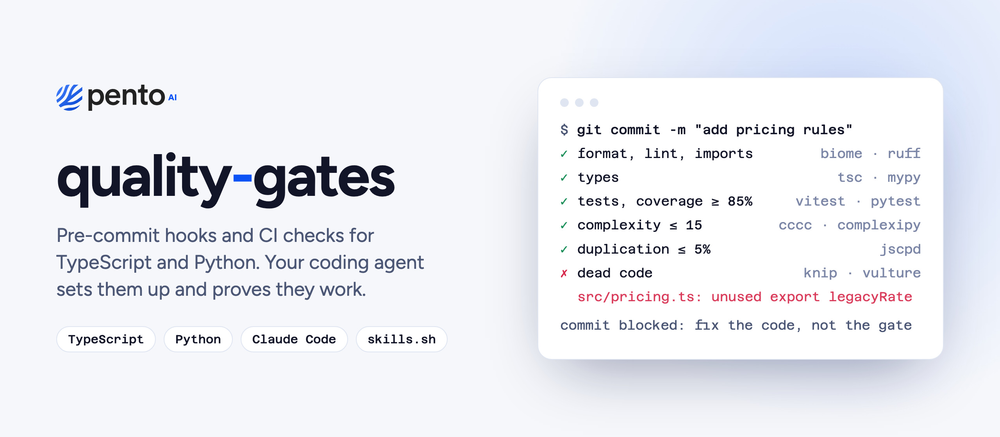

<picture>
  <source media="(prefers-color-scheme: dark)" srcset="assets/banner-dark.png">
  
</picture>

# quality-gates

An agent skill that adds quality gates to a TypeScript or Python repository: the same checks
run on every commit and in CI, so a change that breaks formatting, types, tests, complexity,
duplication or dead-code rules never lands.

Your coding agent does the setup. It surveys the repo, installs the tools, adapts the configs,
measures the code as it is today, sets each threshold so nothing can get worse, and proves
every hook blocks a bad commit before it reports back.

## Set it up: paste this to your agent

Open your coding agent (Claude Code, Codex, Cursor, or any agent that can run shell commands)
in the repository and paste:

```text
Set up quality gates in this repository with the quality-gates skill from pentoai/quality-gates.

1. Install the skill into this project:
   npx skills add pentoai/quality-gates --skill quality-gates --yes
   If you cannot run npx, clone https://github.com/pentoai/quality-gates into a temporary
   folder and use skills/quality-gates from there.
2. Read the skill's SKILL.md and follow its workflow end to end: survey the repo, install
   the tools, copy and adapt the templates, calibrate the thresholds to the code as it is
   today, and prove that the hooks and the CI workflow work.
3. Ask me before you replace an existing linter, formatter, type checker or test runner.
   Use the skill's defaults for everything else.
4. Finish with a short report: what you added, every threshold that differs from the
   defaults and why, every suppression, and what I still need to do on GitHub.
```

The skill stays in the project, so the next agent session knows how to fix a failing gate
instead of loosening it.

## What it sets up

| Gate | TypeScript | Python | Default |
| --- | --- | --- | --- |
| Format, lint, import order | [Biome](https://biomejs.dev) | [Ruff](https://docs.astral.sh/ruff/) | errors fail |
| Cognitive complexity per function | Biome | [complexipy](https://github.com/rohaquinlop/complexipy) | 15 |
| Cyclomatic complexity and size per function | [cccc](https://github.com/moznion/cccc), Biome | Ruff (`C901`, `PLR091x`) | TS 40, Python 15 |
| Types | `tsc`, strict flags | [mypy](https://mypy-lang.org), strict | 0 errors |
| Tests and coverage | [Vitest](https://vitest.dev) | [pytest](https://pytest.org) + pytest-cov | 85% in logic layers |
| File maintainability | [FTA](https://ftaproject.dev) | | score 60 |
| Duplication | [jscpd](https://github.com/kucherenko/jscpd) | jscpd | 5%, plus new clones on PRs |
| Dead code and dependencies | [knip](https://knip.dev) | [vulture](https://github.com/jendrikseipp/vulture), [deptry](https://deptry.com) | 0 findings |
| Git hooks | husky + lint-staged | [pre-commit](https://pre-commit.com) | every commit |
| CI | GitHub Actions `verify.yml` | GitHub Actions `verify.yml` | every PR and push to `main` |
| One command for everything | `pnpm verify` | `uv run pre-commit run --all-files` | |

A repo with both languages gets both recipes, with one hook manager and one CI workflow. The
skill also covers npm, yarn and bun, Next.js and Vite, monorepos, FastAPI and Django, Python in
a subdirectory, and repos that already use ESLint, Prettier, Jest, Black or pyright.

## Existing codebases

Most codebases do not meet every target on day one. The skill measures each gate first, fixes
what is cheap, suppresses single offenders in place with a reason, and sets any broadly
exceeded threshold to the worst value the code has today, with the target written next to it.
From then on the thresholds only move down. The gates land green, and nothing gets worse.

When a gate fails later, the rule the agent follows is to fix the code, not the gate.

## Other ways to install

**skills.sh** (Claude Code, Codex, Cursor, OpenCode and [many more](https://skills.sh)):

```sh
npx skills add pentoai/quality-gates
```

**Claude Code plugin:**

```text
/plugin marketplace add pentoai/quality-gates
/plugin install quality-gates@pento
```

**By hand:** copy `skills/quality-gates/` into your agent's skills folder (`.claude/skills/`,
`.agents/skills/`, and so on).

Then ask your agent to "set up quality gates in this repo".

## What is in this repository

```text
skills/quality-gates/
  SKILL.md                  the workflow the agent follows
  references/
    typescript.md           install, templates and variants for TypeScript
    python.md               install, templates and variants for Python
    calibration.md          adopting the gates on an existing codebase
  templates/
    typescript/             biome.json, vitest.config.ts, fta.json, cccc.toml, knip.json,
                            .jscpd.json, husky hooks, cccc scripts, verify.yml, AGENTS.md block
    python/                 pyproject.toml fragment, .pre-commit-config.yaml, .jscpd.json,
                            verify.yml, AGENTS.md block
.claude-plugin/             Claude Code marketplace and plugin manifests
```

## Contributing

Issues and pull requests are welcome. Every template change should be tried on a real
project first: apply it, run the one command for the language, and show a bad commit being
refused.

## License

[MIT](LICENSE)

---

<a href="https://pento.ai">
  <picture>
    <source media="(prefers-color-scheme: dark)" srcset="assets/pento-logo-white.svg">
    
  </picture>
</a>

Built by [Pento](https://pento.ai). The gates are extracted from the setup we run on our own
products. If you want help bringing AI-native engineering practices to your team,
[get in touch](https://pento.ai/contact).
